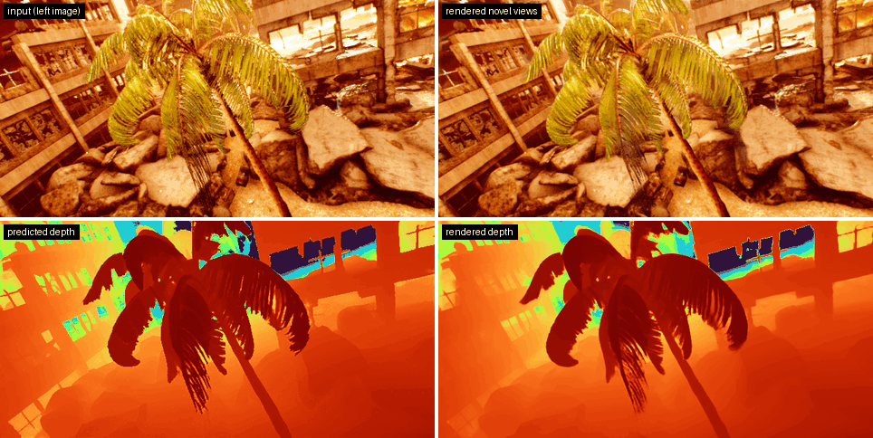

<p align="center">

  <h1 align="center">StereoSplat: Metric-Scale Novel View Synthesis via Stereo-Grounded Gaussian Splatting</h1>
  <!-- TODO(owner): affiliations line. -->
  <p align="center">
    <a href="https://vladimiryugay.github.io/"><strong>Vladimir Yugay</strong></a>
    &middot;
    <a href="https://rozumden.github.io/"><strong>Denis Rozumny</strong></a>
    &middot;
    <a href="https://staff.fnwi.uva.nl/th.gevers/"><strong>Theo Gevers</strong></a>
    &middot;
    <a href="https://scholar.google.com/citations?user=5w7RLQQAAAAJ&amp;hl=en"><strong>Elias Vansteenkiste</strong></a>
    &middot;
    <a href="https://oswaldm.github.io/"><strong>Martin R. Oswald</strong></a>
    &middot;
    <a href="https://scholar.google.com/citations?user=VZ1Q5v4AAAAJ&amp;hl=en"><strong>Diogo C. Luvizon</strong></a>
  </p>
  <p align="center">NeurIPS 2026 &ndash; Sydney, Australia</p>
  <h3 align="center"><a href="https://arxiv.org/abs/2610.35902">Paper</a> | <a href="https://vladimiryugay.github.io/stereosplat/">Project Page</a> | <a href="https://huggingface.co/facebook/stereo-splat">Model Weights</a> | <a href="https://huggingface.co/datasets/facebook/xrstereo">XRStereo Dataset</a></h3>
  <div align="center"></div>
</p>

<p align="center">
  
</p>
<p align="center"><sub>Three consecutive stereo pairs from <a href="https://tartanair.org">TartanAir V2</a> (Apocalyptic) -> metric 3D Gaussians.
Left: input left image and predicted depth. Right: novel views and depth rendered along a spiral camera path around the first input camera.</sub></p>

StereoSplat reconstructs metric-scale 3D Gaussians from a short sequence of
calibrated stereo pairs in a single feed-forward pass, and renders novel views
and depth. Geometry comes from a frozen stereo backbone,
[FoundationStereo](https://github.com/NVlabs/FoundationStereo). A light decoder
with cross-view attention predicts per-pixel Gaussians, which are aggregated
across views with learned, depth-adaptive weights. Stereo gives metric depth, so
the reconstructions and the rendered depth are in meters, and the model works
with poses from a stereo visual odometry system such as
[MAC-VO](https://github.com/MAC-VO/MAC-VO) instead of ground truth.

## &#x1F4CA; Results

Novel view synthesis with the released weights and MAC-VO poses, following the
paper protocol: windows of 3 stereo pairs, and the middle pair is rendered. We
produced these numbers with this repository. They match Table 1 of the paper
after rounding.

| Benchmark | PSNR | SSIM | LPIPS | AbsRel | delta1 (%) |
|---|---|---|---|---|---|
| Infinigen | 29.41 | 0.954 | 0.116 | 0.033 | 98.56 |
| TartanAir v2 | 26.25 | 0.944 | 0.101 | 0.058 | 94.95 |
| KITTI (zero-shot) | 25.20 | 0.941 | 0.101 | 0.044 | 95.98 |

SSIM is multi-scale SSIM (`sssim` in `metrics.json`). AbsRel and delta1 are
computed on the rendered depth of the novel view.

Depth accuracy (delta1, %) against feed-forward baselines, which use
ground-truth poses:

| Benchmark | StereoSplat | DepthSplat | pixelSplat |
|---|---|---|---|
| Infinigen | 98.6 | 63.0 | 40.1 |
| TartanAir v2 | 94.9 | 78.7 | - |
| KITTI (zero-shot) | 96.0 | 79.8 | - |

## &#x2699;&#xFE0F; Setting Things Up

Clone the repo:

```
git clone https://github.com/facebookresearch/stereo-splat.git
cd stereo-splat
```

Clone FoundationStereo at the commit we tested. NVIDIA releases it under its own
license, so it is not part of this repo:

```
git clone https://github.com/NVlabs/FoundationStereo third_party/FoundationStereo
git -C third_party/FoundationStereo checkout 6e8806816b533e4d13ddbb95ffa907b797060a62
```

`third_party/FoundationStereo` is the default location. To use a checkout
elsewhere, set `FOUNDATION_STEREO_ROOT=/path/to/FoundationStereo`. See
[`third_party/README.md`](third_party/README.md) for details.

Run the following commands to set up the environment:

```
conda create -n stereosplat python=3.10 -y
conda activate stereosplat
```

Install PyTorch. We tested with the CUDA 13.0 build, which needs an NVIDIA
driver that supports CUDA 13.0 (R580 or newer):

```
pip install torch==2.13.0 torchvision==0.28.0 --index-url https://download.pytorch.org/whl/cu130
```

Install the other dependencies and the package:

```
pip install -r requirements.txt
pip install -e .
```

A regular `pip install .` also works, since the split files in `data/splits`
are installed with the package. In that case set `FOUNDATION_STEREO_ROOT`,
because `third_party/` is not part of the installed package.

`gsplat` 1.4.0 from PyPI compiles its CUDA kernels the first time it is used.
This takes a few minutes, and the result is cached in
`~/.cache/torch_extensions`. It needs a CUDA toolkit of the same major version
as your PyTorch build (CUDA 13 for the wheels above): `nvcc` on `PATH` and
`CUDA_HOME` pointing to a toolkit that includes the CUDA runtime headers:

```
export CUDA_HOME=/usr/local/cuda-13.0 PATH=/usr/local/cuda-13.0/bin:$PATH
python -c "import torch, gsplat; print(gsplat.__version__)"
```

We tested the build with `nvcc` 13.0 against the CUDA 13.0 PyTorch wheels. Set
`TORCH_CUDA_ARCH_LIST` (e.g. `8.0` for A100) to compile only for your GPU. You
can also install a prebuilt `gsplat` 1.4.0 wheel that matches your PyTorch and
CUDA versions (see the [gsplat documentation](https://docs.gsplat.studio/)).

The DINOv2 code inside FoundationStereo is fetched with `torch.hub` from
[facebookresearch/dinov2](https://github.com/facebookresearch/dinov2) at commit
`7764ea0f912e53c92e82eb78a2a1631e92725fc8` the first time the model is built.
To work offline, set `STEREOSPLAT_DINOV2_REPO` to a local dinov2 checkout of that
commit. No pretrained weights are downloaded through `torch.hub` or `timm`; all
backbone weights come from the FoundationStereo checkpoint.

All configs read paths from two environment variables:

```
export DATA_ROOT=/path/to/processed_datasets   # see "Getting the Data"
export CKPT_ROOT=$PWD/checkpoints              # see "Checkpoints"
```

Run the unit tests (CPU) with `pip install pytest && pytest tests`.

We tested our code on NVIDIA A100 GPUs with Linux, Python 3.10, PyTorch 2.13.0,
torchvision 0.28.0 and gsplat 1.4.0 (pinned versions in
[`requirements.txt`](requirements.txt)). Training, evaluation and rendering in
the demo need a CUDA GPU.

## &#x1F528; Running StereoSplat

<details>
<summary><b>Getting the Data</b></summary>

Every dataset except XRStereo is converted to the same layout: one folder per
sequence with per-frame PNG images and `.npy` depth maps, plus camera-to-world
poses and intrinsics. XRStereo is read as released.
[`scripts/prepare_data/README.md`](scripts/prepare_data/README.md) has the
download links, the expected raw layout and the conversion commands.

| Dataset | Role | Folder under `${DATA_ROOT}` | Split file |
|---|---|---|---|
| TartanAir (v1) | training | `tartanair_processed/` | `data/splits/tartan/train.txt` |
| Infinigen stereo video (InfinigenSV) | training + evaluation | `infinigen_processed/` | `data/splits/infinigen_static/{train,test}.txt` |
| XRStereo | training | `xrstereo/sequences/` | `data/splits/xrstereo/train.txt` |
| TartanAir v2 | evaluation | `tartanair_v2_processed/` | `data/splits/tartanv2/test.txt` |
| KITTI Visual Odometry (static segments) | zero-shot evaluation | `kitti_static/` | `data/splits/kitti_static/test.txt` |
| MAC-VO poses (optional) | external poses for evaluation | `macvo_poses/` | see [`docs/macvo_poses.md`](docs/macvo_poses.md) |

The Infinigen training and test scenes are stereo video sequences of the public
Hugging Face dataset [`MatchLab/Infinigen`](https://huggingface.co/datasets/MatchLab/Infinigen)
(InfinigenSV, CC BY-NC-SA 4.0).
TODO(owner): confirm that the paper's Infinigen numbers are reproducible from
these public scenes.

XRStereo is the synthetic stereo video dataset introduced with StereoSplat,
released on Hugging Face as
[`facebook/xrstereo`](https://huggingface.co/datasets/facebook/xrstereo)
(CC BY-NC 4.0). It is read directly after extracting its tar shards; no
conversion is needed.

The datasets are not redistributed here. You download them from their
providers and are responsible for complying with their licenses (see
[`scripts/prepare_data/README.md`](scripts/prepare_data/README.md#licenses)).

Relative split-file paths in the configs are resolved against the current
directory first and then the repository root. Training and evaluation stop with
an error if a scene listed in a split file is missing under `DATA_ROOT` or a
dataset ends up empty, and log the number of scenes and windows per dataset at
startup. To run on a deliberately partial copy of the data, set
`allow_missing_scenes: true` (globally or per dataset) or pass
`--allow-missing-scenes`.
</details>

<details>
<summary><b>Checkpoints</b></summary>

The released checkpoint holds only the StereoSplat weights (decoder,
cross-view attention and aggregation). FoundationStereo stays frozen in
StereoSplat, so its weights are not redistributed: they are loaded from NVIDIA's
release.

```
bash scripts/download_weights.sh        # into ${CKPT_ROOT:-checkpoints}
```

The script downloads `stereosplat_v1.safetensors` from
[Hugging Face](https://huggingface.co/facebook/stereo-splat) at a pinned
revision, verifies its sha256, and prints instructions for the FoundationStereo
weights. The model config is stored in the file metadata.

Download the FoundationStereo **ViT-S model `11-33-40`** from the links in the
[FoundationStereo README](https://github.com/NVlabs/FoundationStereo). NVIDIA
releases it under its own license, and it is not redistributed here. Expected
layout:

```
${CKPT_ROOT}/
  stereosplat_v1.safetensors
  foundation_stereo/11-33-40/
    cfg.yaml
    model_best_bp2.pth   # sha256 8d7850b9dc68d1366722a02a39745704b1db41471211be6abd93ef463727e6be
```

The configs point to this folder with
`model.fs_checkpoint_path: ${oc.env:CKPT_ROOT}/foundation_stereo/11-33-40`.
</details>

<details>
<summary><b>Evaluation</b></summary>

Evaluation uses windows of 3 consecutive stereo pairs. The first and last pairs
are the input, and the middle pair is rendered and compared with the ground
truth: PSNR, SSIM, LPIPS, and AbsRel / delta1 of the rendered depth.

```
python scripts/evaluate.py --config configs/eval_tartanv2.yaml \
    --checkpoint ${CKPT_ROOT}/stereosplat_v1.safetensors \
    --poses-dir ${DATA_ROOT}/macvo_poses \
    --output-dir outputs/eval_tartanv2
```

Use `configs/eval_kitti.yaml` and `configs/eval_infinigen.yaml` for the other
benchmarks. `torchrun --nproc_per_node=N scripts/evaluate.py ...` splits the
test set across GPUs.

With `--poses-dir`, every dataset is evaluated twice: with ground-truth poses
(`<dataset>_NVS_gt`) and with the external poses
`<poses_dir>/<dataset>/<sequence>/<pose_type>.npy` (`<dataset>_NVS_ext`, the
paper protocol for StereoSplat). Without `--poses-dir`, only ground-truth poses
are used.

Other options: `--pose-type` (default `poses_left_aligned_scaled`, used for all
paper numbers), `--pose-modes gt,ext`, `--num-views`, `--batch-size`,
`--scale-align-depth` (median-scale alignment before the depth metrics; off for
the paper numbers), `--profile-runtime` and OmegaConf dot-list overrides. A
summary is printed at the end and, with `--output-dir`, written to
`metrics.json`, plus TensorBoard logs in `tensorboard/`.

[`docs/macvo_poses.md`](docs/macvo_poses.md) describes how to produce the MAC-VO
poses, and their exact format and alignment.
TODO(owner): link the precomputed MAC-VO poses for the test splits if their
release is approved.
</details>

<details>
<summary><b>Training</b></summary>

`configs/train_stereosplat.yaml` is the recipe of the paper model: model,
loss, optimizer, schedule and training data (TartanAir v1, Infinigen and
XRStereo; see "Getting the Data"). To train without one of the datasets,
disable it with a null override, e.g. `training_datasets.xrstereo=null`;
results then differ from the released weights.

The paper model was trained on 40 GPUs (5 nodes x 8) with batch size 1 per GPU.
On a single 8-GPU node, gradient accumulation over 5 batches keeps the same
effective batch size of 40:

```
torchrun --nproc_per_node=8 scripts/train.py --config configs/train_stereosplat.yaml \
    --output-dir outputs/stereosplat optimization.grad_accum_steps=5
```

On 5 nodes, run on each node (no accumulation):

```
torchrun --nnodes=5 --nproc_per_node=8 --node_rank=$NODE_RANK \
    --rdzv_backend=c10d --rdzv_endpoint=$MASTER_ADDR:29500 \
    scripts/train.py --config configs/train_stereosplat.yaml --output-dir outputs/stereosplat
```

Options: `--output-dir` (default `logging.output_dir` in the config),
`--batch-size` (per GPU), `--num-views` (stereo pairs per sample) and OmegaConf
dot-list overrides, e.g. `optimization.epochs=2`. To initialize the model from
a checkpoint (release or training format), add
`init_checkpoint_path=/path/to/checkpoint` (weights only).

Recipe: 10 epochs at 320x640 with 3 stereo pairs per sample, all of them input
and target views. AdamW (weight decay 0.01) with a per-epoch learning rate:
epoch 0 runs at `min_lr` (1e-5), then a cosine decay from 1e-3 at epoch 1
towards 1e-5. Loss: 0.8 L1 + 0.2 (1 - SSIM) + 0.05 LPIPS (VGG) on the rendered
images and 0.5 L1 on the rendered depth (pixels with ground-truth depth in
(0, 80) m). There is no data augmentation. FoundationStereo stays frozen and in
eval mode; only the StereoSplat modules (5.1M parameters) are trained. The
validation set is a random 10% of the training windows (seed 0), and
`best_checkpoint.pt` has the best validation NVS PSNR. With other batch sizes,
either keep the effective batch size of 40 with `optimization.grad_accum_steps`
or scale `optimization.lr` and `min_lr` linearly with it; results with other
settings may differ.

The output directory contains `config.yaml`, TensorBoard logs
(`tensorboard/`), `checkpoints/last_checkpoint.pt` (written after every epoch)
and `checkpoints/best_checkpoint.pt`. Checkpoints hold the StereoSplat weights
(not the FoundationStereo weights), the model config and the optimizer,
LR-scheduler and RNG states. To continue an interrupted run with the same
config:

```
torchrun --nproc_per_node=8 scripts/train.py --config configs/train_stereosplat.yaml \
    --output-dir outputs/stereosplat optimization.grad_accum_steps=5 \
    --resume outputs/stereosplat/checkpoints/last_checkpoint.pt
```

Training restarts at the epoch after the one stored in the checkpoint (a
partially finished epoch is redone) and continues the LR schedule, data order
and global step. On GPU the resumed run is close to, but not bitwise identical
with, the uninterrupted run, because the Gaussian aggregation uses
`scatter_add_`, which is nondeterministic on CUDA. After training, the model is
evaluated on the `test_datasets` of the config with ground-truth poses (disable
a dataset with e.g. `test_datasets.kitti=null`, or all of them with
`test_datasets=null`). For the paper protocol (MAC-VO poses), use
`scripts/evaluate.py`; it accepts training checkpoints directly. To convert a
checkpoint to the release format:

```
python scripts/export_weights.py \
    --checkpoint outputs/stereosplat/checkpoints/best_checkpoint.pt \
    --output checkpoints/stereosplat_public.safetensors
```

The LPIPS loss downloads the torchvision VGG16 ImageNet weights on first use
(`~/.cache/torch/hub/checkpoints/vgg16-397923af.pth`), and the LPIPS metric of
validation and testing downloads the AlexNet weights
(`~/.cache/torch/hub/checkpoints/alexnet-owt-7be5be79.pth`); on machines without
internet access, copy both files there first. The comparison images written to
TensorBoard are large (several MB each; one every
`optimization.vis_every_n_steps` training steps plus up to 8 per validation and
test pass), so raise `vis_every_n_steps` if the log directory grows too much.
</details>

<details>
<summary><b>Demo</b></summary>

Reconstruct Gaussians from a rectified stereo pair and render novel views. This
needs a CUDA GPU; add `--no-render` to only export the `.ply`, which also works
on CPU:

```
python scripts/demo.py \
    --left path/to/left.png --right path/to/right.png \
    --intrinsics FX FY CX CY --baseline 0.25 \
    --checkpoint ${CKPT_ROOT}/stereosplat_v1.safetensors \
    --fs-checkpoint-dir ${CKPT_ROOT}/foundation_stereo/11-33-40 \
    --output-dir outputs/demo
```

For a short stereo sequence, put the images in `<dir>/left/` and `<dir>/right/`
(paired in sorted order), and pass metric left-camera camera-to-world poses
(OpenCV axes; `.npy` of shape `(N, 4, 4)` or a text file with 12 or 16 values
per line):

```
python scripts/demo.py --sequence-dir path/to/seq --poses path/to/seq/poses_left.npy \
    --max-frames 4 --stride 1 \
    --intrinsics FX FY CX CY --baseline 0.25 \
    --checkpoint ${CKPT_ROOT}/stereosplat_v1.safetensors --output-dir outputs/demo_seq
```

Intrinsics are in pixels of the input images. Images are resized and
center-cropped to `--img-size` (default `320 640`, the training resolution).

The demo writes:

<ul>
<li><code>gaussians.ply</code> in the standard 3D Gaussian Splatting layout, which
opens in common 3DGS viewers (<code>--ply-sh-degree</code>, default 3, zero-pads the
higher SH orders);</li>
<li>the predicted depth of the input views;</li>
<li>rendered RGB and depth for the first input camera and for
<code>--num-views</code> cameras on a small orbit (<code>--orbit-radius</code>,
default the baseline; <code>--forward</code>);</li>
<li><code>cameras.json</code>.</li>
</ul>

`--checkpoint` and `--fs-checkpoint-dir` default to the `CKPT_ROOT` layout from
"Checkpoints".
</details>

## &#x1F4CC; Citation

If you find our paper and code useful, please cite us:

<!-- TODO(owner): add the proceedings reference (pages / volume) once available. -->

```bib
@inproceedings{yugay2026stereosplat,
  title     = {StereoSplat: Metric-Scale Novel View Synthesis via Stereo-Grounded Gaussian Splatting},
  author    = {Yugay, Vladimir and Rozumny, Denis and Gevers, Theo and Vansteenkiste, Elias and Oswald, Martin R. and Luvizon, Diogo C.},
  booktitle = {Advances in Neural Information Processing Systems (NeurIPS)},
  year      = {2026}
}
```

## &#x1F4DC; License

StereoSplat code, model weights and the XRStereo dataset are released under
the CC BY-NC 4.0 license, see [LICENSE](LICENSE).

Third-party components keep their own licenses:

- FoundationStereo code and weights (NVIDIA, non-commercial license) are not
  redistributed. You get them from the upstream repository and NVIDIA's
  release.
- Files adapted from Depth Anything 3 (Apache-2.0) keep their original
  copyright headers and are marked as modified (see
  [`third_party/README.md`](third_party/README.md) and [NOTICE](NOTICE)).
- Datasets are not redistributed and are subject to their own terms (see
  [`scripts/prepare_data/README.md`](scripts/prepare_data/README.md#licenses)).

## &#x1F64F; Acknowledgements

This work builds on several open-source projects, and we thank their authors:

- [FoundationStereo](https://github.com/NVlabs/FoundationStereo) for the stereo
  backbone and pretrained weights.
- [Depth Anything 3](https://github.com/ByteDance-Seed/Depth-Anything-3), from
  which parts of the Gaussian adapter, renderer, spherical-harmonics and
  geometry utilities are adapted.
- [gsplat](https://github.com/nerfstudio-project/gsplat) for differentiable
  Gaussian rasterization.
- [MAC-VO](https://github.com/MAC-VO/MAC-VO) for the stereo visual odometry
  poses used in evaluation.

We also thank the creators of TartanAir, TartanAir v2, KITTI, Infinigen and
InfinigenSV for making their data available.
