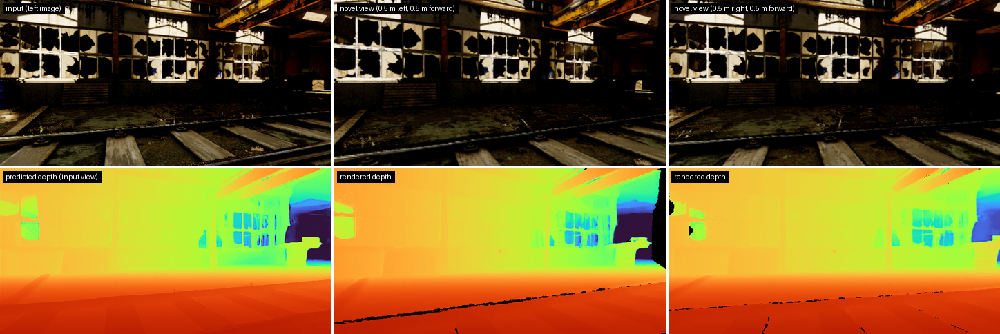

# StereoSplat: Metric-Scale Novel View Synthesis via Stereo-Grounded Gaussian Splatting

**NeurIPS 2026**

<!-- TODO(owner): paper, project page and Hugging Face links (placeholders below). -->
[Paper](#) | [Project page](#) | [Model weights](https://huggingface.co/facebook/stereo-splat)

<p align="center">
  
</p>
<p align="center"><sub>Single stereo pair from <a href="https://tartanair.org">TartanAir V2</a> (AbandonedFactory2) -> metric 3D Gaussians;
novel views rendered 0.5 m to the side and 0.5 m forward. Produced with <code>scripts/demo.py</code>.</sub></p>

StereoSplat reconstructs metric-scale 3D Gaussians from a short sequence of
calibrated stereo pairs in a single feed-forward pass and renders novel views
and depth. Geometry is grounded on a frozen stereo backbone
([FoundationStereo](https://github.com/NVlabs/FoundationStereo)); a light
decoder with cross-view attention predicts per-pixel Gaussians that are
aggregated across views with learned, depth-adaptive weights. Because stereo
gives metric depth, the reconstructions and rendered depth are in meters, and
the model can be used with poses from a stereo visual odometry system
(e.g. [MAC-VO](https://github.com/MAC-VO/MAC-VO)) instead of ground truth.

## Results

Depth accuracy (delta1, %) of rendered novel views. StereoSplat uses MAC-VO
visual-odometry poses; the baselines use ground-truth poses.

| Benchmark | StereoSplat | DepthSplat | pixelSplat |
|---|---|---|---|
| Infinigen | 98.6 | 63.0 | 40.1 |
| TartanAir v2 | 94.9 | 78.7 | - |
| KITTI (zero-shot) | 96.0 | 79.8 | - |

TODO(owner): add PSNR / SSIM / LPIPS / AbsRel from the paper tables, or link
to them.

## Contents

- [Installation](#installation)
- [Data](#data)
- [Pretrained weights](#pretrained-weights)
- [Training](#training)
- [Evaluation](#evaluation)
- [Demo](#demo)
- [Citation](#citation)
- [License](#license)
- [Acknowledgements](#acknowledgements)

## Installation

Tested on Linux with Python 3.10, PyTorch 2.4.1 / torchvision 0.19.1 (CUDA 12.1
wheels), gsplat 1.4.0 and NVIDIA A100 GPUs (pinned versions in
[`requirements.txt`](requirements.txt)). A CUDA GPU is required for training,
evaluation and rendering in the demo.

```bash
git clone --recursive https://github.com/facebookresearch/stereo-splat.git
cd stereo-splat

conda create -n stereosplat python=3.10 -y
conda activate stereosplat

pip install torch==2.4.1 torchvision==0.19.1 --index-url https://download.pytorch.org/whl/cu121
pip install -r requirements.txt
pip install -e .
```

A regular `pip install .` also works (the split files in `data/splits` are
installed with the package); in that case set `FOUNDATION_STEREO_ROOT` (see
below), since `third_party/` is not part of the installed package.

`gsplat` 1.4.0 from PyPI compiles its CUDA kernels the first time it is used
(a few minutes; the result is cached in `~/.cache/torch_extensions`). This
needs a CUDA 12 toolkit: `nvcc` on `PATH` and `CUDA_HOME` pointing to a toolkit
that includes the CUDA runtime headers, e.g.

```bash
export CUDA_HOME=/usr/local/cuda-12.1 PATH=/usr/local/cuda-12.1/bin:$PATH
python -c "import torch, gsplat; print(gsplat.__version__)"
```

We tested the JIT build with `nvcc` 12.8 against the CUDA 12.1 PyTorch wheels.
Set `TORCH_CUDA_ARCH_LIST` (e.g. `8.0` for A100) to compile only for your GPU.
Alternatively, install a prebuilt `gsplat` 1.4.0 wheel matching your PyTorch
and CUDA versions (see the [gsplat documentation](https://docs.gsplat.studio/)).

Run the unit tests (CPU) with `pip install pytest && pytest tests`.

### FoundationStereo backbone

StereoSplat uses the official, unmodified FoundationStereo code from a git
submodule in `third_party/FoundationStereo` (see
[`third_party/README.md`](third_party/README.md)). If you cloned without
`--recursive`:

```bash
git submodule update --init --recursive
```

<!-- TODO(owner): add the submodule and record the pinned commit (needs GitHub access). -->

To use a FoundationStereo checkout elsewhere, set
`FOUNDATION_STEREO_ROOT=/path/to/FoundationStereo`. The DINOv2 code used inside
FoundationStereo is fetched with `torch.hub` from
[facebookresearch/dinov2](https://github.com/facebookresearch/dinov2) at the
pinned commit `7764ea0f912e53c92e82eb78a2a1631e92725fc8` the first time the
model is built (set `STEREOSPLAT_DINOV2_REPO` to a local dinov2 checkout of that
commit to work offline). No pretrained weights are downloaded through
`torch.hub`/`timm`; all backbone weights come from the FoundationStereo
checkpoint.

### Paths

All configs read paths from two environment variables:

```bash
export DATA_ROOT=/path/to/processed_datasets   # see "Data"
export CKPT_ROOT=$PWD/checkpoints              # see "Pretrained weights"
```

Training and evaluation stop with an error if a scene listed in a split file
is missing under `DATA_ROOT` or a dataset ends up empty, and log the number of
scenes and windows per dataset at startup. To run on a deliberately partial
copy of the data, set `allow_missing_scenes: true` (globally or per dataset) or
pass `--allow-missing-scenes`.

## Data

See [`scripts/prepare_data/README.md`](scripts/prepare_data/README.md) for
download links, the expected raw layout and conversion commands. The configs
expect the processed datasets in the following folders:

```
${DATA_ROOT}/
  tartanair_processed/        TartanAir (v1), training
  infinigen_processed/        Infinigen stereo video (InfinigenSV), training + evaluation
  tartanair_v2_processed/     TartanAir v2, evaluation
  kitti_static/               KITTI Visual Odometry static segments, zero-shot evaluation
  macvo_poses/                optional, external poses for evaluation (docs/macvo_poses.md)
```

| Dataset | Role | Split files |
|---|---|---|
| TartanAir (v1) | training | `data/splits/tartan/train.txt` |
| Infinigen stereo video (InfinigenSV) | training + evaluation | `data/splits/infinigen_static/{train,test}.txt` |
| TartanAir v2 | evaluation | `data/splits/tartanv2/test.txt` |
| KITTI Visual Odometry (static segments) | zero-shot evaluation | `data/splits/kitti_static/test.txt` |

The Infinigen training and test scenes are the stereo video sequences of the
public Hugging Face dataset
[`MatchLab/Infinigen`](https://huggingface.co/datasets/MatchLab/Infinigen)
(InfinigenSV, CC BY-NC-SA 4.0).
TODO(owner): confirm that the paper's Infinigen numbers are reproducible from
these public scenes.

Relative split-file paths in the configs are resolved against the current
directory first and then the repository root.

## Pretrained weights

The released checkpoint contains the StereoSplat decoder (plus the few
FoundationStereo BatchNorm statistics that differ from the public
FoundationStereo weights); all other FoundationStereo weights are loaded from
NVIDIA's release.

```bash
bash scripts/download_weights.sh        # into ${CKPT_ROOT:-checkpoints}
```

The script downloads and verifies `stereosplat_v1.pth` from Hugging Face and
prints instructions for the FoundationStereo weights. The same weights are also
provided as `stereosplat_v1.safetensors` (model config in the file metadata);
`--checkpoint` accepts either file.
TODO(owner): Hugging Face repo id, file name and sha256 in
`scripts/download_weights.sh`.

FoundationStereo: download the **ViT-S model `11-33-40`** from the links in the
[FoundationStereo README](https://github.com/NVlabs/FoundationStereo) (released
by NVIDIA under its own license; not redistributed here). Expected layout:

```
${CKPT_ROOT}/
  stereosplat_v1.pth
  foundation_stereo/11-33-40/
    cfg.yaml
    model_best_bp2.pth   # sha256 8d7850b9dc68d1366722a02a39745704b1db41471211be6abd93ef463727e6be
```

The configs point to this folder with
`model.fs_checkpoint_path: ${oc.env:CKPT_ROOT}/foundation_stereo/11-33-40`.

## Training

```bash
# 8 GPUs on one node
torchrun --nproc_per_node=8 scripts/train.py --config configs/train_stereosplat.yaml \
    --output-dir outputs/stereosplat

# single GPU
python scripts/train.py --config configs/train_stereosplat.yaml
```

Options: `--output-dir` (default `logging.output_dir` in the config),
`--batch-size` (per GPU), `--num-views` (stereo pairs per sample) and OmegaConf
dot-list overrides, e.g. `optimization.epochs=2 optimization.lr=5e-4`. To
initialize the model from a checkpoint (release or training format) add
`init_checkpoint_path=/path/to/checkpoint` (weights only). Multi-node
training works with the usual `torchrun` arguments (`--nnodes`, `--node_rank`,
`--rdzv_endpoint`, ...).

The output directory contains `config.yaml`, TensorBoard logs
(`tensorboard/`), `checkpoints/last_checkpoint.pt` (written after every epoch)
and `checkpoints/best_checkpoint.pt` (best validation NVS PSNR). Both store the
model, optimizer and LR-scheduler state, epoch, global step, best metric and
RNG states. To continue an interrupted run with the same config:

```bash
python scripts/train.py --config configs/train_stereosplat.yaml \
    --resume outputs/stereosplat/checkpoints/last_checkpoint.pt
```

(or set `resume_from` in the config). Training restarts at the epoch after the
one stored in the checkpoint and continues the LR schedule; with the same
number of processes it reproduces the uninterrupted run. After training, the
model is evaluated on the `test_datasets` of the config with ground-truth
poses.

The recipe trains for 10 epochs at 320x640 with 3 stereo pairs per sample,
AdamW (lr 1e-3, 1 linear warm-up epoch, cosine decay to 1e-5), an L1 + SSIM +
LPIPS rendering loss and a depth loss. The validation set is a random 10% of
the training mixture.

Batch size and learning rate: the paper model was trained on 80 GPUs with
batch size 1 per GPU (effective batch size 80), and the LR schedule is defined
per epoch. With fewer GPUs each epoch has more, smaller optimizer steps at the
same peak LR. Two common ways to stay close to the paper setting are (a) keep
the effective batch size with gradient accumulation, e.g. 8 GPUs with
`optimization.grad_accum_steps=10`, or (b) scale `optimization.lr` (and
`min_lr`) linearly with the effective batch size, e.g. 8 GPUs x batch 1 with
`lr=1e-4`. Neither was used for the paper model; results with other settings
may differ.

Training data: the released weights were trained on TartanAir, Infinigen and
an additional dataset that is not publicly available. The provided config
trains on the public TartanAir (v1) and Infinigen training sets only, so a
model trained with it is not expected to match the released weights exactly.

## Evaluation

Evaluation uses windows of 3 consecutive stereo pairs: the first and last
pairs are the input, the middle pair is rendered and compared with the ground
truth (PSNR, SSIM, LPIPS, and AbsRel / delta1 of the rendered depth).

```bash
python scripts/evaluate.py --config configs/eval_tartanv2.yaml \
    --checkpoint ${CKPT_ROOT}/stereosplat_v1.pth \
    --poses-dir ${DATA_ROOT}/macvo_poses \
    --output-dir outputs/eval_tartanv2
```

Use `configs/eval_kitti.yaml` and `configs/eval_infinigen.yaml` for the other
benchmarks; `torchrun --nproc_per_node=N scripts/evaluate.py ...` splits the
test set across GPUs. With `--poses-dir`, every dataset is evaluated twice:
with ground-truth poses (`<dataset>_NVS_gt`) and with the external poses
`<poses_dir>/<dataset>/<sequence>/<pose_type>.npy` (`<dataset>_NVS_ext`, the
paper protocol for StereoSplat). Without `--poses-dir` only ground-truth poses
are used.

Other options: `--pose-type` (default `poses_left_aligned_scaled`, used for all
paper numbers), `--pose-modes gt,ext`, `--num-views`, `--batch-size`,
`--scale-align-depth` (median-scale alignment before depth metrics; off for
the paper numbers), `--profile-runtime` and OmegaConf dot-list overrides. A
summary is printed at the end and, with `--output-dir`, written to
`metrics.json` (plus TensorBoard logs in `tensorboard/`).

How to produce the MAC-VO poses, and the exact pose format and alignment, is
described in [`docs/macvo_poses.md`](docs/macvo_poses.md).
TODO(owner): link the precomputed MAC-VO poses for the test splits if their
release is approved.

## Demo

Reconstruct Gaussians from a rectified stereo pair and render novel views
(requires a CUDA GPU; add `--no-render` to only export the `.ply`, which also
works on CPU):

```bash
python scripts/demo.py \
    --left path/to/left.png --right path/to/right.png \
    --intrinsics FX FY CX CY --baseline 0.25 \
    --checkpoint ${CKPT_ROOT}/stereosplat_v1.pth \
    --fs-checkpoint-dir ${CKPT_ROOT}/foundation_stereo/11-33-40 \
    --output-dir outputs/demo
```

For a short stereo sequence, put the images in `<dir>/left/` and
`<dir>/right/` (paired in sorted order) and pass metric left-camera
camera-to-world poses (OpenCV axes; `.npy` of shape `(N, 4, 4)` or a text
file with 12 or 16 values per line):

```bash
python scripts/demo.py --sequence-dir path/to/seq --poses path/to/seq/poses_left.npy \
    --max-frames 4 --stride 1 \
    --intrinsics FX FY CX CY --baseline 0.25 \
    --checkpoint ${CKPT_ROOT}/stereosplat_v1.pth --output-dir outputs/demo_seq
```

Intrinsics are in pixels of the input images; images are resized and
center-cropped to `--img-size` (default `320 640`, the training resolution).
The demo writes `gaussians.ply` in the standard 3D Gaussian Splatting layout
(opens in common 3DGS viewers; `--ply-sh-degree`, default 3, zero-pads the
higher SH orders), the predicted depth of the input views, rendered RGB and
depth for the first input camera and `--num-views` cameras on a small orbit
(`--orbit-radius`, default the baseline; `--forward`), and `cameras.json`.
`--checkpoint` and `--fs-checkpoint-dir` default to the `CKPT_ROOT` layout
above.

## Citation

<!-- TODO(owner): verify author first names and add the arXiv/proceedings reference. -->

```bibtex
@inproceedings{yugay2026stereosplat,
  title     = {StereoSplat: Metric-Scale Novel View Synthesis via Stereo-Grounded Gaussian Splatting},
  author    = {Yugay, Vladimir and Rozumny, Denis and Gevers, Theo and Vansteenkiste, TODO(owner) and Oswald, Martin R. and Luvizon, Diogo},
  booktitle = {Advances in Neural Information Processing Systems (NeurIPS)},
  year      = {2026}
}
```

## License

StereoSplat is released under the CC BY-NC 4.0 license, see [LICENSE](LICENSE).
TODO(owner): confirm against the approved release license.

Third-party components keep their own licenses:

- FoundationStereo code and weights (NVIDIA, non-commercial license) are not
  redistributed; they are fetched from the upstream repository and NVIDIA's
  release.
- Files adapted from Depth Anything 3 (Apache-2.0) keep their original
  copyright headers and are marked as modified (see
  [`third_party/README.md`](third_party/README.md) and [NOTICE](NOTICE)).
- Datasets are not redistributed and are subject to their own terms (see
  [`scripts/prepare_data/README.md`](scripts/prepare_data/README.md#licenses)).

## Acknowledgements

This work builds on several open-source projects; we thank their authors:

- [FoundationStereo](https://github.com/NVlabs/FoundationStereo) for the stereo
  backbone and pretrained weights.
- [Depth Anything 3](https://github.com/ByteDance-Seed/Depth-Anything-3), from
  which parts of the Gaussian adapter, renderer, spherical-harmonics and
  geometry utilities are adapted.
- [gsplat](https://github.com/nerfstudio-project/gsplat) for differentiable
  Gaussian rasterization.
- [MAC-VO](https://github.com/MAC-VO/MAC-VO) for the stereo visual odometry
  poses used in evaluation.

We also thank the creators of TartanAir, TartanAir v2, KITTI, Infinigen and
InfinigenSV for making their data available.
